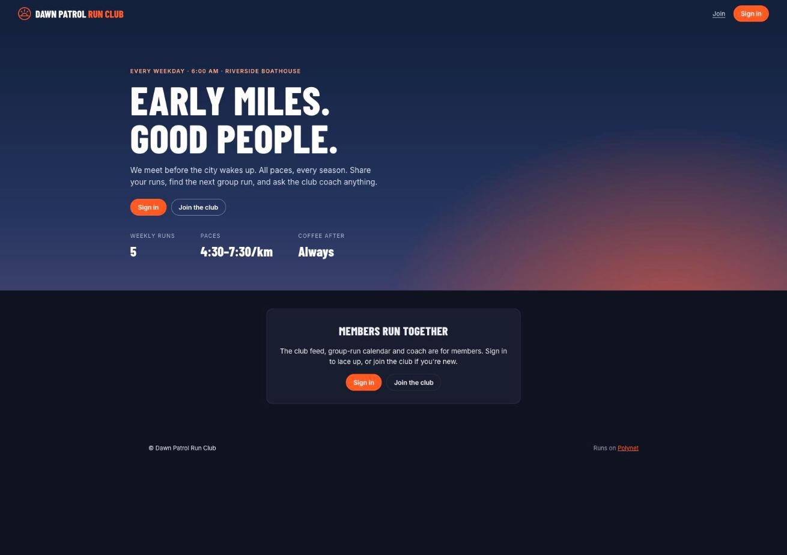
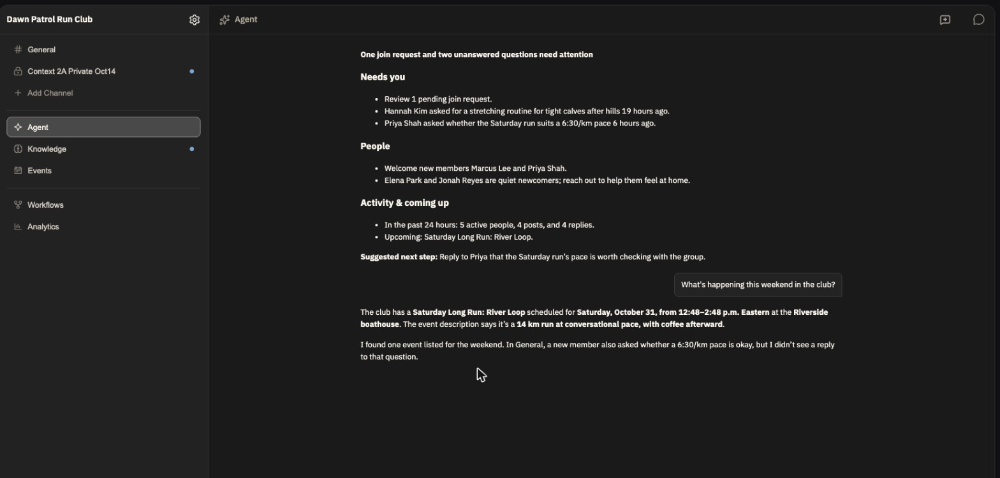

# Polynet

**Communities that think, remember and act.**

Polynet is a managed backend for communities with a built-in AI agent. Founders
run their community on Polynet (members, payments, posts, events, courses,
memory and the community's agent) and give it a website that is entirely
their own, built by their AI agent and served on `<community>.polynet.page`.

- **The community agent** knows the community, answers members, and keeps the
  founder briefed.
- **Community sites** are static sites on the Polynet SDK. A founder's AI agent
  (Claude Code, Codex, Cursor) designs and builds one with `npx @polynet/cli`.
- **Polynet Studio** is where founders run everything else: settings,
  members, billing, messages and analytics.
- **The Polynet MCP** lets builders work on their community from their own
  agent.

The easiest way to use Polynet is the hosted service at
[polynet.ai](https://polynet.ai). Community sites and `@polynet/cli` are in
preview: today they run against Polynet's staging environment.





## Build your community's site in three steps

1. Create a community at [polynet.ai](https://polynet.ai).
2. Set up a site folder for your AI agent:

   ```bash
   npx @polynet/cli create my-site --community <your-community-slug>
   ```

3. Open `my-site` in Claude Code, Codex or Cursor and say *"Design our
   community's site."* Your agent asks about your community, shows you three
   directions live, and builds the one you pick at
   `https://<your-community-slug>.polynet.page`.

## This repository

| Path | What it is |
|---|---|
| `convex/`, `shared/` | The backend, on [Convex](https://convex.dev) |
| `apps/web/` | Polynet Studio (React, Vite) |
| `infra/community-edge/` | The edge that serves community sites (Cloudflare Workers for Platforms), with the SDK and account shell |
| `packages/polynet-cli/` | `@polynet/cli`: create, check and deploy community sites, plus the agent skills |
| `docs/` | Contracts and specs |
| `scripts/` | Contract proofs and the release gate |

Run the checks:

```bash
npm ci
npm run release:gate -- --mode=local
```

Self-hosting is possible (Convex can be self-hosted, and the edge runs on any
Cloudflare account) but isn't documented or supported yet.

## Contributing

See [CONTRIBUTING.md](CONTRIBUTING.md). Report security problems privately:
[SECURITY.md](SECURITY.md).

## License

Open source in two layers: **AGPL-3.0** for the platform and **MIT** for the
CLI, SDK and builder tools. See [LICENSING.md](LICENSING.md). The Polynet name
and logo are covered by [TRADEMARK.md](TRADEMARK.md).
