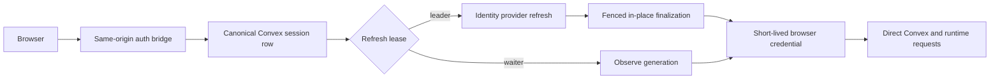

# Auth Session Architecture

Status: implemented reference architecture

Scope: web authentication continuity for the same-origin bridge, Convex, and runtime HTTP

Goal: one simple, server-owned session lifecycle with direct browser-to-runtime authorization

## 1. Irreducible Model

The system has four jobs:

1. The identity provider proves identity.
2. One opaque cookie identifies one server session row.
3. That row owns the encrypted upstream refresh secret and explicit lifetime.
4. The browser receives only replaceable, short-lived runtime credentials.

The cookie is a lookup key, not an authorization claim. Convex remains canonical
for the session record and application authorization remains fail-closed at each
runtime boundary.

## 2. Ownership

### Browser

- HTTP-only session cookie, inaccessible to application JavaScript
- short-lived access token and public user snapshot
- tab-local sign-in UX state

### Same-origin auth bridge

- `auth/start`
- `auth/callback`
- `session/bootstrap`
- `session/refresh`
- `session/logout`
- secure cookie issuance and clearing

### Convex

- one canonical `authSessions` row for a live login
- encrypted refresh continuity
- refresh generation and server lease
- idle expiry, absolute expiry, revocation, and diagnostic truth
- verified application identity and authorization

## 3. Stable Session Invariant

A successful refresh updates the existing terminal session row. It does not
insert a replacement row and does not rotate the browser cookie.

The only normal session-row insert is initial sign-in. Legacy replacement rows
remain readable so existing cookies can walk to their terminal row. On the next
successful bootstrap or refresh, the bridge writes that terminal ID back to the
cookie. No new replacement chains are created.

## 4. Refresh Concurrency

Refresh is coordinated in the canonical database, not only in one browser tab:

1. A mutation atomically claims a short refresh lease for the current generation.
2. Exactly one caller becomes leader.
3. Other callers wait for the generation to advance and reuse the winner's result.
4. A crashed leader's expired lease can be reclaimed.
5. Finalization requires the exact lease ID and expected generation.
6. A stale finalizer cannot overwrite credentials written by a newer leader.

Lease expiry permits takeover; it does not by itself invalidate a still-owning
leader. Exact lease and generation fencing decides write authority.

## 5. Lifetime and Revocation

- idle lifetime: 30 days, sliding with authenticated use
- absolute lifetime: 90 days, never extended
- first use of a legacy row initializes both windows to avoid a rollout-wide logout
- logout, terminal refresh failure, and expiry revoke the row
- revocation erases encrypted credentials and any refresh lease
- transient provider failures release the lease and preserve a still-valid access token

## 6. Request Flow

## 7. Non-Goals

- proxying all application traffic through the bridge
- treating the cookie as a bearer token
- creating a second application identity plane
- retaining browser-owned refresh secrets
- maintaining unused refresh/update/rotation mutations for hypothetical callers

## 8. Required Proof

The contract is acceptable only while tests prove:

- concurrent claims elect one leader and keep one row
- crashed leases can be reclaimed
- stale finalizers lose
- idle and absolute expiry fail closed
- revocation erases stored credentials
- legacy replacement cookies resolve to the terminal row
- refresh code cannot call a row-rotation mutation
