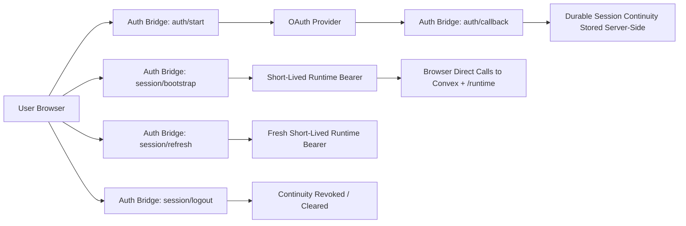

# Auth Session Target Architecture (Daytona Worktree)

Status: active reference architecture  
Scope: web-native authenticated session posture for Convex + runtime HTTP endpoints  
Goal: simple, scalable, reliable, robust, secure, efficient, and premium

Implementation posture note:
The currently chosen implementation is the browser-owned SPA continuity model described in [`/Users/neilmcdevitt/code/arx/.worktrees/daytona/docs/auth-session-spa-posture-v1.md`](/Users/neilmcdevitt/code/arx/.worktrees/daytona/docs/auth-session-spa-posture-v1.md).

## 0) Irreducible Problem

This system only has to solve 5 things:

1. Prove identity
2. Preserve session continuity
3. Refresh session safely
4. Authenticate browser-direct runtime requests
5. Recover cleanly across reloads, tabs, sign-out, and auth callback flows

Any design that adds more moving parts than necessary should be rejected unless it materially improves one of those five.

## 1) Current State

The current system is a hardened token-owning SPA.

What the browser currently owns:

1. Access token
2. Refresh token
3. Expiry metadata
4. User profile snapshot
5. PKCE verifier/state during sign-in

What improved recently:

1. OAuth callback is now code-only
2. PKCE state is session-scoped
3. Auth-flow pending state is session-scoped
4. Persisted cloud session is session-scoped instead of localStorage-scoped

What did **not** change:

1. The browser still owns the durable refresh secret
2. The browser still performs refresh in JavaScript
3. The browser still authenticates Convex/runtime requests with a live bearer

That means the current posture is better than before, but the architectural ceiling is unchanged.

## 2) Real Constraint: Convex

The key constraint is not generic OAuth theory. The key constraint is Convex.

The browser currently talks directly to:

1. Convex authenticated mutations/queries
2. Runtime HTTP endpoints
3. Community and workspace surfaces built on those authenticated calls

That means any stronger auth architecture must answer one hard question:

**How does the browser obtain a runtime-valid short-lived bearer that Convex and the runtime HTTP surface will both accept directly?**

If that question cannot be answered cleanly, the system degenerates into one of two worse outcomes:

1. Full app proxy / BFF for most traffic
2. Two competing auth planes

Both add major complexity and should be avoided unless truly necessary.

## 3) Architecture Options

### Option A: Hardened SPA

Browser owns:

1. Session continuity
2. Refresh token
3. Access token

Pros:

1. Smallest implementation
2. Efficient direct browser-to-Convex traffic
3. Operationally simple
4. Works now

Cons:

1. Browser remains the durable secret holder
2. XSS still means session compromise
3. Security ceiling is limited

Verdict:

Good interim posture. Not the premium end state.

### Option B: Full BFF / proxy

Browser owns:

1. Cookie-backed app session only

Server owns:

1. All session continuity
2. All upstream token exchange
3. All authenticated traffic mediation

Pros:

1. Strongest isolation
2. Browser never holds bearer secrets directly

Cons:

1. Highest complexity
2. More latency
3. Larger operational surface
4. Fights the current browser-direct Convex/runtime model

Verdict:

Too heavy for the current architecture unless the product intentionally moves toward a full backend-controlled web app.

### Option C: Server-Owned Session Continuity + Browser-Held Ephemeral Bearer

Browser owns:

1. Short-lived runtime bearer
2. User profile snapshot
3. Tab-local auth UX state

Server owns:

1. Durable session continuity
2. Refresh token or upstream auth continuity
3. Revocation truth

Pros:

1. Stronger than the current SPA
2. Keeps most app traffic browser-direct
3. Avoids full BFF complexity
4. Preserves efficient direct Convex/runtime calls if feasible

Cons:

1. Requires an auth bridge
2. Requires a clean Convex-compatible short-lived bearer story
3. Does not eliminate XSS risk, only reduces blast radius
4. Adds bootstrap/refresh infrastructure dependency

Verdict:

This is the recommended target **if and only if** the Convex bearer story is feasible without creating a second messy auth plane.

## 4) Recommended Target

The target architecture is:

**server-owned session continuity + browser-held ephemeral bearer**

This means:

1. Browser no longer holds the durable refresh secret
2. Browser still gets a short-lived bearer for direct Convex/runtime requests
3. Session continuity lives behind a same-origin auth bridge
4. The app remains efficient because normal app traffic does not need a full proxy hop

## 5) Token / State Classes

### Durable session continuity

Owned by the auth bridge:

1. Refresh token
2. Upstream provider continuity
3. Revocation state
4. Session lifetime policy

### Ephemeral runtime auth

Owned by the browser:

1. Short-lived bearer accepted by Convex/runtime
2. Expiry metadata

### Browser-local UX state

Owned by the browser:

1. User snapshot
2. Pending auth intent
3. Signed-out marker
4. PKCE/tab-local state during transitions

The browser should not hold durable session continuity after the migration.

## 6) Target Component Model

### Auth bridge

Same-origin server layer responsible for:

1. `auth/start`
2. `auth/callback`
3. `session/bootstrap`
4. `session/refresh`
5. `session/logout`

### Browser app

Responsible for:

1. Starting sign-in
2. Bootstrapping session on load
3. Holding short-lived bearer only
4. Re-requesting fresh short-lived bearer when needed
5. Performing direct Convex/runtime traffic

### Convex + runtime

Remain authoritative for:

1. Verified identity
2. Authenticated actor bootstrap
3. Runtime access control
4. Thread/project/community authorization

The auth bridge does not replace the runtime access-control model. It only changes who owns session continuity.

## 7) Target Flow

## 8) Non-Goals

This target does **not** mean:

1. Proxy all app traffic through a backend
2. Remove direct Convex access
3. Eliminate all XSS risk
4. Redesign runtime authorization

It only means:

1. Move durable session continuity out of browser JavaScript
2. Keep browser-held auth short-lived and replaceable

## 9) Feasibility Gates

Do not implement this target until these questions are answered concretely.

### Gate 1: Convex bearer feasibility

Can the auth bridge provide a short-lived bearer that:

1. Convex accepts directly
2. Runtime HTTP endpoints accept directly
3. Aligns with `ctx.auth.getUserIdentity()` and verified identity

If not, the target architecture is not yet viable.

### Gate 2: Single auth plane

Can the bridge avoid creating a second conflicting identity plane?

The system must not end up with:

1. one notion of identity in the bridge
2. a different notion in Convex/runtime

### Gate 3: Premium UX

Can bootstrap and refresh remain fast enough that the experience still feels premium?

If bootstrap/refresh becomes flaky or slow, the theoretical security win may not be worth the UX cost.

### Gate 4: Logout / revocation truth

Can logout clear continuity cleanly enough that:

1. the browser cannot silently rehydrate stale auth
2. sign-out remains fail-closed
3. revocation is coherent across tabs and reloads

## 10) Migration Phases

### Phase 0: Hardened SPA

This is the current state:

1. code-only callback
2. session-scoped PKCE
3. session-scoped pending auth state
4. session-scoped persisted session

### Phase 1: Bridge design + feasibility

Before writing production code:

1. prove the Convex bearer feasibility
2. define bridge endpoints
3. define token/session lifetimes
4. define logout semantics

### Phase 2: Bootstrap bridge

Add:

1. `session/bootstrap`
2. browser startup path that asks the bridge for a short-lived bearer

Keep the existing SPA session path as fallback until verified.

### Phase 3: Refresh bridge

Move refresh continuity behind:

1. `session/refresh`

At this point the browser should stop holding the durable refresh secret.

### Phase 4: Remove browser continuity ownership

Delete:

1. browser refresh-token persistence
2. browser refresh-token usage
3. any legacy callback/session path that restores durable continuity in the browser

## 11) Interim Recommendation

Until Phase 1 feasibility is proven, the current recommendation is:

1. keep the hardened SPA posture
2. do not pretend it is the final premium posture
3. do not jump to a full BFF
4. treat server-owned session continuity as the target only if the Convex auth boundary can support it cleanly

## 12) Bottom Line

The current system is acceptable and much better than it was, but it is still a browser-owned continuity model.

The recommended destination is **not** “make the app a giant proxy.”

The recommended destination is:

**server-owned session continuity + browser-held ephemeral bearer**

That is the cleanest path to a stronger, still-efficient premium auth posture for this Daytona runtime, assuming the Convex bearer feasibility gate is satisfied.
