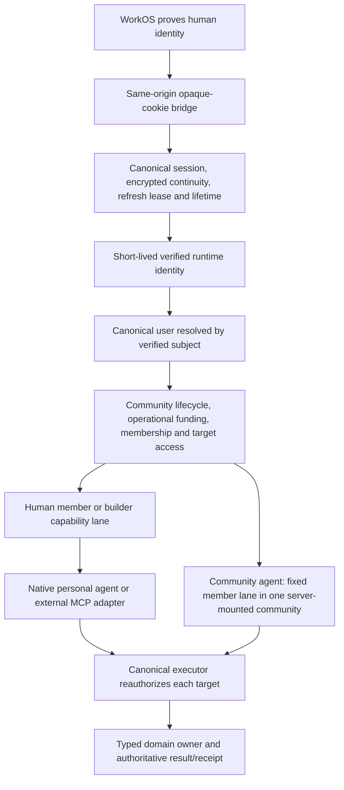

# Chunks 1-3: staging baseline, authority and context assessment

Observed: 2026-10-14. Algorithm step: **1 — understand, question and rank**.
Scope: read-only staging investigation and local source/fixture verification.
No runtime source, deployed configuration, memberships, payments, credentials,
provider connections or inference were changed.

The machine-readable, sanitized evidence is
[assessment evidence](evidence/chunks-1-3-staging-20261014.json).
This is a dated assessment, not a release certificate or progress ledger.

## Outcome

The existing identity and semantic context foundation is worth preserving.
Nineteen examined core files are byte-identical between staging and canonical
main. Local behavior checks passed, and live read boundaries behaved as expected
within the limits below. There is no evidence here requiring a new identity
system, ontology engine, agent runtime or frontend framework.

**Staging is not an aligned acceptance baseline for canonical main.** Its web
source is 16 commits behind main, its live backend exposes the older default
entry interface, and no exact deployed Convex source SHA is available from the
health/function metadata examined. Fix baseline provenance before interpreting
new staged behavior as proof of canonical-main behavior.

| Chunk | What was completed | Remaining acceptance boundary |
| --- | --- | --- |
| C01 | Exact source/ref/web/backend-host reconciliation, changed-domain inventory, compilation and scoped proof baseline | Exact backend commit is unverified; staging does not yet contain main's last 16 commits; one existing static proof is stale |
| C02 | Identity/session/role/funding/agent authority map, local behavior tests, live unauthenticated denial and administrator-mediated read checks | No real WorkOS OAuth login/refresh or authenticated external-MCP bearer acceptance was performed |
| C03 | Existing semantic object/path/action coverage, privacy boundaries, source parity and executor tests | Full founder application API coverage is absent; live positive MCP traversal with real bearer credentials remains unverified |

## C01. Exact baseline

| Layer | Observed source or target | Evidence class |
| --- | --- | --- |
| Canonical main | `0a100cfb544851ab06da25f93d8ad549db917ee4` | Remote Git ref |
| Production web | `91d28dc2c986ef88a8a507a269db710d6d28d878` | Serving version marker; main differs only by release receipt |
| Staging Git and web | `1fc266e1ddaf3880491e7a7d3fdfa1bb32dfcfa4` | Remote ref and serving version marker match |
| Staging source date | 2026-09-24 | Commit metadata; 16 main-only commits, no staging-only commits |
| Staging web | `https://polynet-staging.vercel.app` | Live public origin |
| Embedded backend | `https://quick-porcupine-949.convex.cloud` and `.convex.site` | Extracted from the serving index bundle |
| Backend deployment | `dev:quick-porcupine-949` | Explicit CLI target, public health and live function metadata |
| Staging WorkOS/OAuth server | `https://sparkling-artist-49-staging.authkit.app` | Protected-resource/authorization-server metadata |
| Assessment worktree | `/Users/neilmcdevitt/.codex/worktrees/chunks-1-3-staging/arx` | Isolated checkout based on remote staging |
| Assessment branch | `codex/staging-chunks-1-3` | No runtime changes; only this report/evidence are added |

The staging index bundle was `/assets/index-ToVY_uz_.js`, SHA-256
`87ffb386fa4dbc70081dfa7917eecbd1ded29588aa3344b4746be6f94f9cae4f`.
Local build output is separate compilation evidence and is not asserted to match
that deployed bundle or its environment.

### Backend provenance: what we can and cannot prove

The read-only live function specification contains 735 registrations: 348
mutations, 277 queries, 69 actions and 41 HTTP actions. These counts include
internal and compatibility surfaces; they are not required external endpoints.
Its SHA-256 is recorded in the evidence JSON. A function-spec fingerprint is a
fingerprint of interface metadata, not implementation bytes or a commit.

The live `memberEntryDestination:resolveMemberEntryDestinationInternal` is an
internal **Mutation** accepting `nowMs`, matching the older staging interface.
Canonical main makes it an internal **Query** and removes `nowMs`. Therefore the
examined backend interface is demonstrably behind canonical main. Health and
interface matching cannot establish its exact source commit.

The deployed metadata also contains the expected community-context, self-context
and builder-dossier query identities. This establishes registered interfaces,
not the complete implementation identity of those owners.

### Main-only differences relevant to this assessment

| Domain | Staging source | Canonical main | Consequence |
| --- | --- | --- | --- |
| Default entry | May autojoin the Polynet home community via a mutation | Explicit join; bounded last-visited/owned/joined selection, then Discover | Do not run default entry as a read-only live probe; it can change membership on staging |
| Operator-funded AI/tools | Older operator complimentary funding path | Raw-cost usage-cycle reservation and settlement | Do not use staging as proof of current main's spend limits |
| Home member AI usage | Lacks current monthly member allowance behavior | 25-turn monthly allowance and mention/private-agent enforcement | Native AI usage acceptance is outside this no-inference assessment |
| Owner self/workflow context | Same examined source, preceding later acceptance receipt | Later acceptance receipt on main | Source parity does not copy a historical receipt onto this live backend |
| Web dependency overrides | Older DOMPurify/brace-expansion resolutions | Patched resolutions on main | Preserve as explicit catch-up scope; no dependency changes were made here |
| Release workflow | Git-driven production release description | Exact-main local release script and main auto-deploy disabled | Reconcile source instructions before release; do not infer authorization from a stale runbook |

The human-supplied repository instructions prohibit direct local production
Vercel release commands. That instruction still governs this task even though
main's current runbook differs. No release command was run. This disagreement
must be resolved before a production release; it does not block read-only staging
assessment.

### Local verification against the exact staging source

| Check | Result | Scope |
| --- | --- | --- |
| Web TypeScript check | Pass | Current web/shared code compiles |
| Convex TypeScript check | Pass | Current backend source compiles without push/codegen |
| Web build | Pass | Local compilation only |
| Bundle budget | Pass | 15 JS chunks; 3,166.7 KiB total under current raw-byte budget |
| Focused behavior suite | 97 passed, 0 failed across 9 files | Auth/session, ontology admission, canonical executor/receipts, member/workflow context and prompt projection |
| Canonical operation proof | Pass | Native/MCP schemas, owners and public five-tool boundary |
| Semantic repository proof | Pass | Bounded namespace/projection contracts |
| Auth-session kernel proof | Pass | Source-level refresh/session invariants |
| Official MCP auth proof | Pass | Source-level OAuth/identity contracts |
| Official MCP provider proof | Pass | Shared five-operation definitions and transport setup |
| Member ontology static proof | Fail | Obsolete document assertion, described below |
| Full release gate | Not run | No whole-platform or release-ready claim |

The ontology proof fails at its document regex expecting
`There is no community-agent-internal member lens in v1`. The current document
instead defines a distinct, lease-authorized `workflow_execution` lens and keeps
it separate from human manager reads. Both proof and document are identical in
staging and main. This is an existing proof/contract reconciliation issue; the
failure does not establish a runtime disclosure bug. It was not edited here.

## C02. Identity and authority map

| Responsibility | Owner | What never grants authority |
| --- | --- | --- |
| Identity proof | [auth identity](../../convex/authIdentity.ts), [JWT config](../../convex/auth.config.ts), WorkOS | An asserted subject/email/user ID by itself |
| Session continuity | `api/auth/`, [sessions](../../convex/authSessions.ts), [lifecycle core](../../convex/authSessionLifecycleCore.ts) | Cookie text as an entitlement; browser-owned refresh secrets |
| User bootstrap vs reads | [actor resolver](../../convex/authActor.ts), [auth](../../convex/auth.ts) | Automatic provisioning/relinking inside an ordinary read |
| Community operational state | [builder access](../../convex/communityBuilderAccessCore.ts), [lifecycle](../../shared/communityLifecycle.ts) | Membership or payment overriding archive; grandfathering inventing hosted-AI funding |
| Member/role access | [community core](../../convex/communityCore.ts), [capability context](../../convex/communityCapabilityContext.ts) | UI-selected community, a cached role or Published visibility |
| Channel/object access | [channel access](../../convex/communityChannelAccess.ts), canonical domain readers | Community membership bypassing private-channel/source permissions |
| Human agent authority | [Polynet authority](../../shared/polynetAuthority.ts) | A model/skill/prompt deciding that its user is a builder |
| Community service authority | [executor](../../convex/polynetCanonicalExecutor.ts), [agent channel access](../../convex/communityAgentChannelAccess.ts) | A sponsor's owner/admin privileges; access outside its server mount |
| Private workflow execution | [membership context](../../convex/communityMembershipContextCore.ts), [form evidence](../../convex/communityFormEvidenceCore.ts) | Selecting another subject, an arbitrary run or a different activation/visit |
| Context bytes and audit | [prompt](../../shared/runtimePrompt.ts), [manifest](../../shared/runtimeContextManifest.ts), [composition](../../convex/runtimeHarnessComposition.ts) | Prompt sections/manifests becoming a second authorization plane |

A verified identity may exist before a stored Polynet user. `auth:getActor` can
return authenticated/free state without a `dbUserId`; this neither provisions a
user nor grants community access. Bootstrap is the separate mutation. Ordinary
actor resolution requires the canonical existing user and rejects mismatched
subject/user selectors.

Refresh owns one server row, lease and generation; expiry/revocation fence
continuity and erase credential material. Per-operation access still matters:
a valid session is not a community entitlement. Native turns bind one community
and history; changed context governs later invocations, not stored history.

The community-owned actor is deliberately constrained even when its sponsor is
an owner. It cannot list the platform root, select another community, use the
builder projection, or read a human's private `/members/me/` subtree. An
external harness is a transport using human authority, not an independently
enrolled agent member. Platform operator status is not universal community
membership.

### Live boundary exercises and limits

| Exercise | Observed result | Evidence class |
| --- | --- | --- |
| Backend public health | Success on the embedded staging backend | Live unauthenticated query |
| MCP initialize/tools-list/root-list without bearer | OAuth challenge; matching protected resource and authorization server | Live public HTTP metadata smoke |
| Public authenticated read with an unverified asserted subject | `verified_identity_required` | Live query denial, no product write |
| Public actor read with administrator-supplied existing fixture identity | Stored actor resolved and matched the fixture | Live administrative identity simulation, not OAuth/JWT acceptance |
| Same simulated identity with another asserted subject | `auth_subject_mismatch` | Live administrative identity simulation |
| Simulated unprovisioned identity read | No stored actor; no user created | Live read-only query |
| Internal trusted actor matching the existing disposable-community owner | `owner_builder` context | Live internal server-boundary query |
| Internal trusted actor with mismatched subject/user tuple | `community_not_accessible` | Live internal query denial |
| Invalid/unknown community selector | `invalid_community_slug` / `community_not_accessible` | Live internal query denial |
| Calling internal context query as a simulated ordinary user | Function is not user-callable | Internal/public registration boundary; no missing-function defect inferred |

Only pre-existing staging fixture metadata was used; no private answer/resource
content or credential values are included in this report/evidence. Admin-injected
identities bypass provider credential validation. These checks do **not** prove a
real browser login, session refresh, MCP bearer exchange, member revocation or
cross-community private-content traversal in the deployed environment. Local
executor tests cover the named privacy/scope/replay behaviors with synthetic
in-memory data.

## C03. Ontology and context coverage

The ontology currently has supported community domain objects and typed
relationships; it is not a general schema designer. Cloud records own identity,
access, money, content and history. Semantic paths/Markdown expose authorized
meaning; they are not a second mutable database.

The five public agent operations are unchanged between staging and main:
`polynet_list`, `polynet_read`, `polynet_search`, `polynet_write`, `polynet_call`.
They share one executor and typed domain owners. A native runtime additionally
has execution/history/prompt responsibilities; the external MCP does not imply
access to every private native primitive.

| Object/context | Current canonical agent coverage | Boundary / missing operation |
| --- | --- | --- |
| Platform root and accessible community directory | Bounded list with advancing cursor and current access | Listing is not admission or community creation |
| User profile | Self and permissioned profile projections under `/users/` | No unrestricted user-row browser or automatically enrolled agent identity |
| Community identity | `community.md` and authorized community directory | Context declaration does not grant settings, billing or lifecycle mutation |
| Member relationships | Bounded current membership documents and legacy handleless relationship paths | Not all private member facts or admin roster operations |
| Member self context | `/members/me/context.md`, current actor resolved server-side; bounded progress and pinned submitted-form evidence | Read-only; excludes builder prompts/internal assessments; community-owned agent denied |
| Channels and contributions | Authorized list/read/search; natural chat writes with canonical attribution and retry handling | Private channel checks still apply; generic channel/grant administration is not exposed by five verbs |
| Resources/modules | Bounded list/read/search over one body/content owner | Ordinary readers do not gain draft or builder source visibility |
| Builder resources | Authorized builder directory/read and changeset staging | Staging a proposal is not approval/publication; terminal manager decisions are separate |
| Calendar events | Bounded current/upcoming listing and exact read paths with canonical zoned times | Does not expose general calendar/event authoring through MCP |
| Accepted intelligence | Bounded indexed search/read with current source/citation checks and retrieval evidence | Raw evidence/resources/accepted memory remain separate; no arbitrary node write or exhaustive graph query |
| Outcome feedback | Versioned `community.memory.record_outcome` capability | Requires actual retrieval/node relationship and idempotency; not free-form memory mutation |
| Builder workflow dossier | `/builder/workflow-members/` member documents and `forms.md` | Current manager authority required; no permission to publish private answers or execute arbitrary workflows |
| Internal workflow context | Lease/attempt/run/subject/activation-bound reader | Not a human/MCP selectable general agent lens |
| Integration context | Bounded HubSpot pilot path guards in executor | Live adapter is null; unavailable; not a general integration platform |
| Private native conversations | Canonical member/community-bound persistence and native prompt history | No general conversation filesystem mount exists in the five-tool namespace |

The parser rejects traversal, percent-encoded selectors, backslashes, duplicate
slashes and invalid canonical path forms. Every target is reauthorized after
resolution. Owner/admin builder projection and the community-owned member lane
are distinct. Search results must return follow-up paths that round-trip into
authorized reads; an index/citation/path is a locator, not access authority.

Bounded projections expose truncation/incompleteness instead of claiming a full
roster, history or fact set. Private member answers are contextual data, not
trusted instructions, shared knowledge or deterministic goal-completion proof.

### Local behavior actually verified

The 51 canonical-executor tests in the selected suite cover, among other named
cases: actor-specific member/builder/community-agent lanes; retired/self/other
member context denial; reauthorization after path resolution; builder dossier and
private forms; custom-channel isolation; event/activity list-read round trips;
root search follow-up paths; write attribution/idempotency; receipt-completion
crash recovery; builder proposal/terminal-decision separation; and exact memory
outcome replay. The other selected suites cover refresh leases/lifetimes,
ontology admission, deterministic member/context rendering and prompt projection.
All are local fixtures against the staging source; none are live provider runs.

### Founder application gaps

| Needed for a claimed independent experience | Current foundation | What remains to prove |
| --- | --- | --- |
| Login/admission and current entitlement | WorkOS/bridge and existing domain owners | Supported external auth/admission contract, real authenticated staging acceptance |
| Authorized useful context | Five-tool namespace and domain projections | Real MCP member/builder traversal on an identified backend source |
| One shared contribution | Canonical natural chat write and receipts | External client committed-read/retry/revocation acceptance |
| One verified progress action | Workflow/form owners and builder/self read context | Versioned external operation adapter; current read coverage does not expose execution |
| Lifecycle and data portability | Archive/restore; deletion quarantine | Accepted retention/export/teardown contract before promising those operations |
| Events/webhooks/analytics subscriptions | Existing domain/provider receipts and metrics | No universal outward event bus/subscription/export contract is established |

## Requirement scrutiny and next slice

| Requirement | Source | Credible minimum / conclusion |
| --- | --- | --- |
| Use staging | Human request | Named web/backend targets and exact candidate provenance, not branch-name inference |
| Verify before changes | Human request | Read-only live observations and local fixtures; preserve deployed state and source |
| Explicit identity/community authority | Repo invariants and privacy/money facts | Reuse verified actor, current domain access and executor; no second identity plane |
| Headless context | Founder direction | Existing bounded semantic objects and five verbs; no new ontology database |
| Reliable founder experience | Founder direction | One supported admission/context/contribution/progress contract with recovery proof |
| Irreducible simplicity | Repo philosophy | Reconcile drift and unsupported claims before adding a framework/runtime/registry |

Likely avoidable effort ranks as: a new identity/ontology/runtime system (highest),
broad external API generation, framework replacement, then duplicated adapters
and proof maintenance. Actual cost is unmeasured; no numeric idiot-index ratio is
claimed. Current authority/provenance/idempotency safeguards are part of the
minimum required outcome.

The smallest next package is **a staging baseline reconciliation candidate**:

1. Review main's 16 missing commits as explicit admission, cost, dependency and
   release changes; keep unrelated feature work out.
2. Define the exact intended frontend/backend candidate and the deployment
   receipt that will identify both. No existing health/spec output can retroactively
   prove an unavailable backend commit.
3. Separately reconcile the stale ontology document assertion with the existing
   lease-bound workflow lens; prove privacy behavior without weakening it.
4. Once a baseline is intentionally established, run real authenticated member
   and builder MCP list/read/search acceptance and denied-scope checks. Reads
   that record retrieval receipts are operational evidence effects and must be
   classified explicitly; do not silently turn this read-only assessment into
   write/AI/connection acceptance.

This is the proposed next slice, not authorization to deploy, merge, alter
funding, activate an integration or remove protected core. No framework or
ontology rewrite is justified by the findings. Remain at Step 1 until the next
slice's requirements and baseline are reconciled; then apply deletion and its
verification before optimization.
