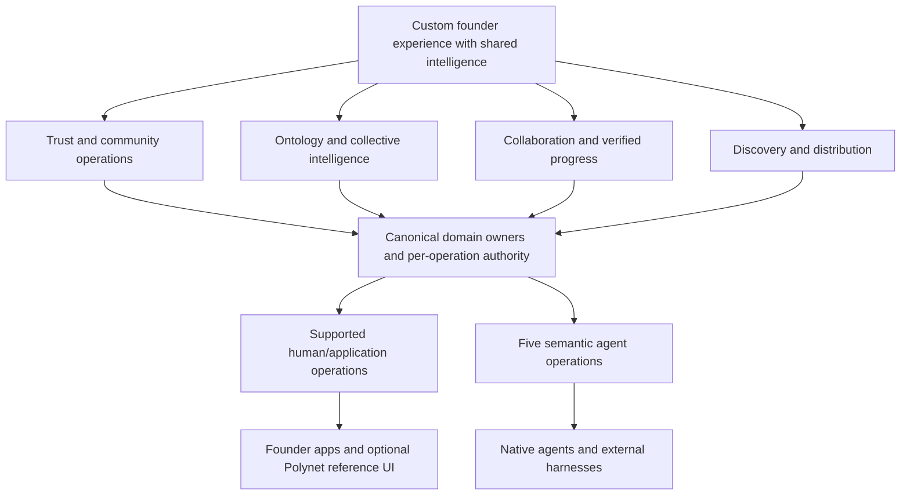

# Polynet: trunk-down approach

Date: 2026-10-14. Algorithm step: **1 — question and rank requirements**.
This is a proposed approach, not a deployment or runtime change.

Current progress and remaining acceptance boundaries are maintained in the
[staging coverage ledger](../archive/polynet-staging-coverage-ledger.md). The source refs,
findings and proposed order below describe the original October 14 assessment.

## Trunk: the product promise

**A founder can build a custom experience whose members and agents share
authorized context, collaborate and make verifiable progress through Polynet.**

Polynet owns the community's durable state, object meaning, permission boundaries
and authoritative outcomes. Founders own the experience built around those
guarantees. Supported external clients must not need a second membership,
entitlement or accepted-memory source of truth.

Ontology/context is the highest product priority. Identity/access is the first
execution dependency. Priority and implementation order are different.

This is a logical dependency map, not a proposal to introduce new services.

## Branches: what must remain true

| Branch | Polynet guarantee | Founder autonomy | Current evidence / gap |
| --- | --- | --- | --- |
| Trust and community operations | Verified identity; canonical membership, roles, channel grants, entitlement, funding and lifecycle | Branding, signup presentation, community navigation and admin experience | Existing domain owners; complete supported external auth/admission/admin contract is unproven |
| Ontology and collective intelligence | Stable supported objects/relationships; scoped context; source evidence, accepted intelligence and outcome lineage | Domain vocabulary, custom views, coaching interpretation and additional application data | Bounded semantic repository/compiler/memory exist; no general schema designer or exhaustive graph API is established |
| Collaboration and progress | Canonical contributions; participant privacy; versioned forms and verifiable progress transitions | Boards, coaching programs, expert-network matching and specialized team workflows | Existing collaboration and bounded workflow owners; external progress authoring/execution coverage needs a defined contract |
| Discovery and distribution | Eligible opt-in community listings and a trustworthy admission destination | Marketing website, positioning, launch and acquisition experience | Existing Discover/gate; broader distribution is a later value hypothesis |

Settings and Create Community belong to these domain operations. A calendar UI
projects event state. Analytics projects canonical evidence. Screens do not each
require a new endpoint family. Hosted agent execution is a bounded service;
external agents use authorized operations without inheriting host authority.

## Ground truth that constrains the approach

The [chunks 1–3 assessment](chunks-1-3-staging-assessment-20261014.md) records
source, deployed observations and verification separately. Remote refs were
rechecked for this map:

- Canonical main: `0a100cfb544851ab06da25f93d8ad549db917ee4`.
- Staging: `1fc266e1ddaf3880491e7a7d3fdfa1bb32dfcfa4`, 16 commits behind main.
- The previous live assessment identified an older backend entry interface;
  exact deployed backend source SHA remains unverified.
- Nineteen examined identity/context files are identical between those refs.
- Ninety-seven focused tests and five source proofs passed in the assessment;
  one ontology proof has an obsolete document assertion. Full release readiness
  and real authenticated MCP acceptance were not established.
- Existing agent interface: `polynet_list`, `polynet_read`, `polynet_search`,
  `polynet_write`, `polynet_call`. Five verbs do not establish coverage of every
  founder application operation.

The implication is to reuse the existing owners, reconcile evidence and expose
missing operations narrowly. These findings do not justify replacing TypeScript,
React/Vite, Convex, identity, the ontology foundation or the agent runtime.

## Leaves: the operation ledger

For each branch, trace a real user outcome down to one operation. Record:

| Field | Required answer |
| --- | --- |
| Outcome and source | What must a member/founder/agent accomplish, and who requires it? |
| Object and relationship | Which canonical entity, scope and revision does it affect? |
| Authority | Which verified principal can act; what must deny access? |
| Existing owner | Which current domain function already owns the outcome? |
| Interface | Current first-party RPC, five-tool capability, or missing supported adapter? |
| Effect and recovery | Product write, retrieval receipt, provider effect, retry key, conflict or lease? |
| Acceptance | Positive, denied/stale and retry/recovery behavior on an identified staging source |
| Classification | Keep; unsupported gap; deletion candidate; protected decision |

Do not export internal functions mechanically. A supported contract must define
scope, inputs, outputs, errors, pagination/versioning where needed, and actual
effects. Application and agent adapters reuse domain owners and authorization.
An SDK or outward event subscription should follow demonstrated client needs.

## Execution order: small proofs before broad conversion

| Order | Consumable package | Exit evidence |
| --- | --- | --- |
| 1 | Finish baseline reconciliation from C01: exact intended main-based staging candidate, frontend/backend provenance, proof/document reconciliation | Identified source for both deployed layers and an honest passing/failing acceptance baseline; production release instructions resolved before any production release |
| 2 | Finish C02/C03 acceptance with real staged member/builder authentication and external MCP | Real credential acceptance; scoped list/read/search; private/cross-community denial; revoked access denied. Classify any retrieval-receipt writes explicitly |
| 3 | Prove a minimal independent founder client with an existing authorized community: context/resource read and one contribution | Custom client uses existing canonical owners; committed read after write; retry does not duplicate; private scope and revocation hold. No mandatory Polynet member UI within this supported slice |
| 4 | Close community operation gaps individually: create/fund, admit, govern channels/roles, manage lifecycle | One supported operation at a time; provider verification, permissions and recovery remain authoritative |
| 5 | Extend the independent experience into one real progress loop: assigned form or milestone, submitted evidence, verified transition and authorized context read | Pinned revisions and private answers; authorized terminal decisions; retries preserve one outcome |
| 6 | Prove intelligence usefulness end to end: eligible evidence, bounded compilation, accepted intelligence, retrieval and outcome feedback | Source/citation authority survives; useful retrieval is distinguishable from raw storage; feedback attaches to actual evidence |
| 7 | Thin the reference UI and remove proven duplicates as parity permits; broaden distribution against measured demand | Replacement journey works, compatibility/data dependencies are traced, and proposed deletion is verified |

Package 3 is a bounded interoperability proof, not the declaration that the whole
platform is headless. Packages 4–6 draw from the existing detailed chunk map;
they do not require rewriting every preceding domain. A domain whose guarantees
already suffice can close with evidence. Backups, telemetry, funding bounds,
privacy and lifecycle review accompany each affected package.

## Requirement ranking before deletion

Qualitative ranking by likely avoidable effort; actual costs are unmeasured and
no numerical idiot-index ratio is claimed.

| Rank | Requirement to question | Credible minimum |
| --- | --- | --- |
| 1 | Replace the framework, identity, ontology or runtime to become headless | Supported adapters around existing verified owners |
| 2 | Publish every internal function or build generic app/schema/workflow hosting | One independent client and the operations its real journey requires |
| 3 | Add a second permissions/context/event system for external builders | Shared canonical authorization and existing receipts; outward delivery only where required |
| 4 | Make every existing screen disappear immediately | Preserve current journeys until external parity and migration are proven |
| 5 | Expand discovery/analytics before proving founder value | Keep existing discovery; validate one valuable community loop first |

Apply the remaining algorithm steps to each bounded package only after its
requirements have been questioned. A proposed deletion needs call-path, data
and behavior evidence. Protected harness/compiler/resources/memory cleanup
retains the repository's explicit human-confirmation boundary.

Baseline reconciliation was the first package proposed by this dated map; use
the current coverage ledger for the next bounded work. This map authorizes no
deployment, production change, provider connection or protected-core deletion.
