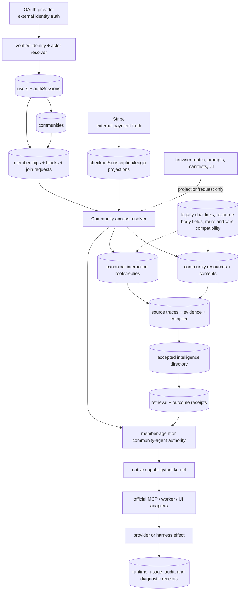

# 02 — Canonical Authority Graph

Scope: cross-system ownership. The graph deliberately distinguishes canonical product state, external canonical state, operational evidence, compatibility state, and projections.

## Authority ownership

| Concern | Canonical or external owner | Derived/operational/compatibility state | Deterministic authority boundary | Confidence |
| --- | --- | --- | --- | --- |
| Request identity | Convex-verified provider identity (`authSubject`) | explicit subject argument | `resolveAuthenticatedSubject` / actor resolver | confirmed |
| Browser continuity | opaque cookie points to `authSessions`; provider owns upstream validity | replacement chain, cookie, diagnostics | same-origin bridge plus session actions | confirmed statically |
| Polynet account/profile | `users`, profile detail and consent records by bounded concern | public user projection | authenticated actor resolver | confirmed; lifecycle incomplete |
| Platform tier | append-history `userEntitlements` | effective tier/gate decision | latest active entitlement resolver and shared gate policy | confirmed, triplicated resolver |
| Community identity/ownership | `communities`; owner is `ownerId` | public/funnel projection | authenticated actor plus owner resolver | confirmed |
| Non-owner access | unique community/user membership pair, block, access source, join request, and provider-derived subscription | capability bundle and required cached member count | indexed unique-pair resolver plus community access resolver | pair reads fail closed on duplicates; cache is staging-reconciled and schema-required |
| Payment | Stripe for settlement/subscription/payment state; Convex for verified product projections and ledgers | redirect and UI status | webhook/provider verification and idempotent lifecycle functions | confirmed static separation; outage convergence untested |
| Community interaction | `communityInteractionRoots`, replies, blocks, attachments, embeds, moderation events | legacy chat rows/link tables are migration compatibility | interaction access/write cores | confirmed; privacy purge incomplete |
| Direct message | conversation, participants, ordered messages | typing and read/activity projections | participant/block/rate checks | confirmed; shared account-deletion ownership defective |
| Resource content | `communityResources` for identity/metadata and `communityResourceContents` for body after migration | legacy inline `communityResources.bodyMd` remains read-first compatibility | resource access plus content helper | confirmed dual-read migration |
| Community knowledge | source traces/evidence -> compiler state -> accepted intelligence -> retrieval/outcome receipts | digests, rankings, archives, runtime context | evidence policy plus intelligence directory | confirmed static architecture |
| Agent context | stored thread/episode plus explicit current community selector and current access | prompt and runtime manifest are orientation | member/community agent and MCP server authority | confirmed; transport duplication exists |
| Native tool meaning | shared tool registry plus Polynet exposure/authority rows | UI schemas, worker adapters, official MCP schemas | server dispatch/authority resolver | confirmed; semantic declarations duplicated across transports |
| Apps/skills | developer app/connection/mount and skill package/revision/install/attachment records | catalog metadata and UI | owner/member authorization and OAuth/provider checks | confirmed; public catalog deferred |
| Workspace/harness | cloud project/thread/runtime/terminal state and external provider state | standalone Workspace UI is a destination/compatibility concern | runtime actions, provider lease, path/tool boundary | protected substrate; UI boundary contradictory |
| Audit/diagnostics | operational evidence tables | operator dashboards are projections | operator authorization plus diagnostic queries | confirmed authority; retention and scale incomplete |

## Things that are never authority

Browser route, redirect, cookie alone, supplied `userId` or `authSubject`, client role boolean, community visibility, funnel response, prompt, runtime manifest, Markdown document, model-selected context, cached member count, operator dashboard, and successful initiating HTTP response are projections or assertions. Every meaningful operation must re-resolve current verified identity, current object authority, and current access or provider state.

## Irreducible separations

1. Platform tier and community-specific paid access are different concerns.
2. Published visibility grants discovery, not membership or entitlement.
3. Personal member-agent and community-owned agent are separate principals.
4. Canonical resources/evidence/intelligence are separate from prompts, digests, rankings, and retrieval receipts.
5. Native tool semantics and authorization may be projected into multiple transports, but should not be re-invented by each transport.
6. Protected workspace/harness capability can remain while standalone Workspace navigation is retired.
7. Ordinary community-builder Stripe Connect payout is not the secondary Builder Partner commission program; they may share provider primitives but not economic authority.
8. Audit preservation and privacy deletion are distinct obligations and need an explicit, field-level retention contract.

## Unresolved graph edges

Provider convergence, account/community deletion behavior, exact privacy/legal retention, backup/restore, external consumers, and authenticated journeys remain unproven. Shared-data ownership and Builder Partner direction are resolved in `05-decisions-builder-partner-and-data-ownership.md`; their runtime migrations are not. Selected legacy-row prevalence is bounded in `04-staging-shape-audit-20260720.md`. Static absence of a call path or zero staging rows never authorizes deletion by itself.
