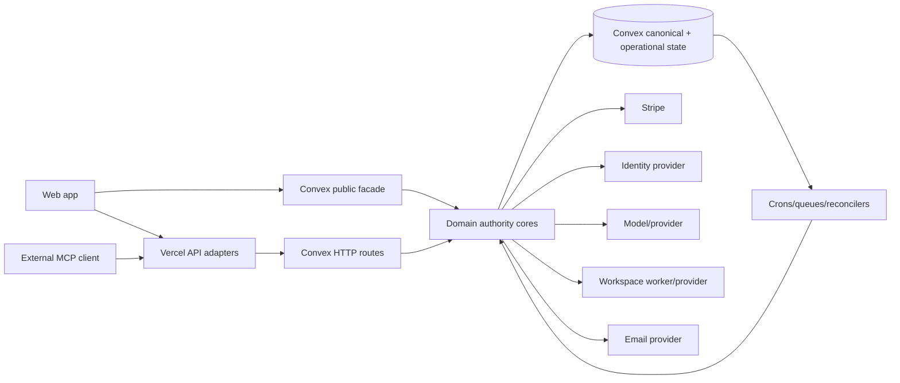

# 03 — Coverage and Topology

## Smallest useful model

Polynet is six irreducible planes, not 124 independent products:

1. **Authority:** verified identity, account, community ownership, membership, entitlement, and operator authority.
2. **Collective state:** interactions, resources, evidence, compiler state, accepted intelligence, and outcomes.
3. **Execution:** member agent, community agent, tools, MCP, apps/skills, workers, and external providers.
4. **Economy:** community access payments, platform tier, workspace/tool credits, creator settlement, and secondary Builder Partner obligations.
5. **Delivery:** browser UI, public/API adapters, funnels, email, previews, and external harness transports.
6. **Evidence and operations:** events, receipts, diagnostics, tests, release markers, backup/restore, and lifecycle cleanup.

Most debt is an extra authority, compatibility adapter, incomplete lifecycle, or unowned projection between these planes. Table count alone is a poor deletion heuristic.

## Required coverage reconciliation

| # | Required domain | Primary dossier | Mechanical assignment | Blunt state |
| ---: | --- | --- | --- | --- |
| 1 | repo, refs, dependencies, supply chain, generated code, CI, release | frontend/public/operations | 72 repository files, 46 release/config files, 249 test/proof files | release and three-graph package ownership are explicit; proof ownership beyond the canonical gates remains weak |
| 2 | env, flags, hosts, backup, restore, rollback | frontend/public/operations | 156 env names, 3 manifests/locks | tracked templates are aligned and package graphs are owned; deployed-name inventory and product-data RPO/RTO restore proof remain open |
| 3 | identity, sessions, account, operator | identity/access + privacy lifecycle | 4 identity tables, 30 identity functions; operator functions separate | actor/session authority is closed on staging; destructive lifecycle execution remains quarantined |
| 4 | profiles, memory, consent, privacy, export, deletion | privacy lifecycle | 7 profile/privacy tables, 20 functions | shared/private ownership policy is explicit; resumable deletion and privacy execution remain incomplete |
| 5 | communities, membership, roles, visibility, funnels, onboarding | identity/access | 10 community-core tables, 76 functions | required core; membership compatibility and observed duplicate/residue backlogs are closed on staging |
| 6 | entitlements, checkout, subscriptions, credits, commissions, payouts | billing/money | 18 tables, 106 functions, 9 crons | Builder Partner v3 and canonical entitlement authority are active; provider convergence and historical legal/ledger reconciliation remain |
| 7 | interactions, DMs, presence, events, notifications | interactions/communications | 30 tables, 84 functions, 8 crons | canonical interaction migration is incomplete; destructive account/community lifecycle is safely quarantined |
| 8 | resources, ingestion, evidence, compiler, intelligence, retrieval | resources/intelligence | 21 tables, 153 functions, 3 crons | protected core has a coherent spine; inline body and legacy chat residue remain |
| 9 | agents, model routing, prompt, context, tools, receipts | agents/tools/apps/MCP | 7 agent/runtime tables, 59 functions, 22 HTTP routes | required; context authority is explicit, but schema/transport duplication is large |
| 10 | native tools, MCP, apps, skills, OAuth, credentials | agents/tools/apps/MCP | 16 tables, 113 functions, 2 HTTP + 2 API routes | private capability is core; public catalog presentation is deferred |
| 11 | workspace/thread substrate, harnesses, workers, terminals, previews | workspace/runtime/async | 10 tables, 115 functions, 3 HTTP routes | protected backend substrate; standalone route/UI state is contradictory |
| 12 | crons, queues, outboxes, retries, leases, cleanup | workspace/runtime/async | all 24 scheduled jobs assigned | most jobs are bounded; several have no durable continuation and can starve work |
| 13 | public/auth APIs, Vercel/Convex boundaries, rate limits | frontend/public/operations | 36 Convex HTTP + 13 API files | delegation is generally explicit; bounds/rate-limit posture is uneven |
| 14 | frontend routes, state, duplicate components, CSS, mobile | frontend/public/operations | 310 frontend files | `App.tsx` and CSS concentrate debt after obsolete surfaces are removed |
| 15 | observability, audit, analytics, incident/legal ownership | frontend/public/operations | 2 evidence tables, 25 functions, 11 ops files | privacy-aware telemetry exists; operator aggregation and retention do not scale |
| 16 | tests, scripts, docs, archives, migrations, fixtures, references | frontend/public/operations | 291 script files, 253 `check:*`, 119 docs, protected references | structural proof volume is high; behavioral/recovery coverage is low |

The generated assignment reports zero fallback schema tables. Counts overlap only where a source surface legitimately projects across domains; the assignment itself is not a claim that each surface should remain.

## Concentration map

| Surface | Size/concentration | Interpretation |
| --- | ---: | --- |
| `apps/web/src/App.tsx` | 9,267 lines | retained state and orchestration concentration; decompose only after C7 acceptance |
| `apps/web/src/base.css` | 27,613 lines after C7.3C | accumulated multi-era UI residue remains after caller-owned deletion |
| `convex/communityResources.ts` | about 10k lines | protected capability plus ingestion/migration/compatibility concentration |
| `convex/builderPartners.ts` | 3,525 lines | substantial retained secondary economy; v3 accrual is community-only 4%, while historical obligations remain versioned |
| `convex/operatorIntelligence.ts` | 2,832 lines | many broad projections; several unbounded full-domain scans/N+1 paths |
| `shared/toolRegistry.ts` | 2,296 lines | canonical native schema gravity; should project rather than be copied |
| `shared/polynetMcp.ts` | 1,200 lines | independent external wire schema with compatibility names |
| `convex/community.ts` | 146 function aliases | de facto web-facing facade; 115 have current first-party runtime references, while source modules remain callable too |
| root `package.json` | 288 scripts, 241 checks | operational discoverability and proof ownership remain concentrated despite canonical CI owners |

## Boundary map

The desired reduction is not one transport. It is one semantic operation and one authority decision per job, with thin versioned adapters for web, Convex HTTP, official MCP, worker, and scheduled execution.

## Main deletion queues

1. **Completed static reductions:** the stale quickstart, stale product-doc destination, no-op/browser-preview template names, unreferenced Discover Apps/Skills CSS, and intermediate `communityExperience` facade are removed on the staging lane.
2. **Migration candidates:** inline resource bodies, legacy community chat/link/attachment reads, absent-membership-active compatibility, duplicate membership rows, legacy retrieval query fields, and old MCP wire names.
3. **Decision-required systems:** exact audit/privacy/legal retention periods remain. Package ownership, Builder Partner v3, shared-content account-deletion ownership, the deferred standalone Workspace destination, and semantic-thesis adoption are resolved; safe lifecycle execution and compatibility retirement remain architecture work.
4. **Never blanket-delete:** coding/community harnesses, compiler, resources/memory, references, canonical interaction/intelligence history, ordinary creator payout, and official MCP capability.
